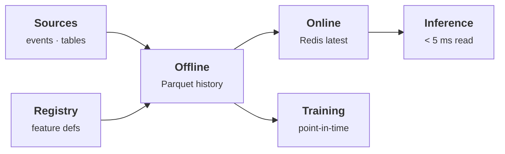

# A feature store without leakage

> One definition per feature, served offline for training and online for inference, with point-in-time joins that never peek at the future.

**Interactive demo:** [natanmartins.com.br/projects/feature-store](https://natanmartins.com.br/projects/feature-store/) · [versão em português](https://natanmartins.com.br/pt/projects/feature-store/)

**Status:** in construction. This README separates what exists from what is planned, and is updated as parts ship.

## The problem

Most production models are worse than their notebooks because training used a value that did not exist yet at prediction time. A feature store exists to make that mistake impossible, and to stop five teams from computing “active users” five different ways.

## Architecture



1. Features are declared once (source, entity, transformation, freshness) in a registry.
2. The offline store keeps full history; training sets are built with point-in-time joins: for each label, the latest feature value strictly before the label’s timestamp.
3. Materialisation jobs push the latest values to Redis for millisecond online reads.
4. A consistency check compares online and offline values for the same entity and time.

**Stack:** Feast · DuckDB / Parquet · Redis · Apache Airflow · Great Expectations

## What exists today

### Real
- The point-in-time join, the TTL rule and the leak detection in the timeline are the actual logic, running in your browser.
- The experiment really trains two logistic regressions on 2,800 rows and scores them on 1,200, computing AUC with the Mann–Whitney statistic.

### Simulated in the browser demo
- Customers and their behaviour are synthetic, generated so that activity stops after churn, which is exactly what makes “latest value” leak.
- The registry entry is illustrative; no Feast server sits behind this page.

### Not built yet (roadmap)
- [ ] Out-of-time evaluation: score “production” on a later cohort instead of the same test rows (today the point-in-time offline/production match is true by construction)
- [ ] Feast repository with offline (Parquet/DuckDB) and online (Redis) stores
- [ ] Materialisation job in Airflow
- [ ] Online/offline consistency check with Great Expectations

## Repository layout

```
demo/   the simulation that powers the interactive page, with tests that check its claims
```

The production pipeline will live alongside it (`pipeline/`, `docker-compose.yml`) as the roadmap items land.

## Run the demo tests

Requires Node.js 22+.

```bash
cd demo
npm test
```

## License

MIT © 2026 Natan Oliveira Martins
